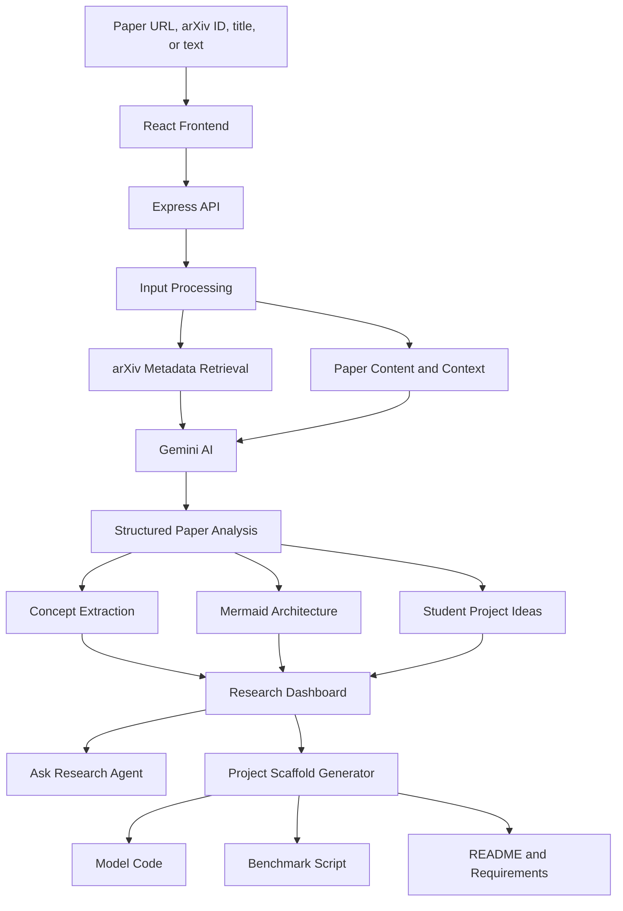

# PaperArchitect

### AI-Powered Research Paper Analyzer & Project Blueprint Generator

PaperArchitect helps computer science students understand academic research papers and turn research insights into practical development projects. It uses Google Gemini to extract key concepts, explain methodologies, generate architecture diagrams, and suggest student-friendly research extensions.

## Features

- **Research paper analysis:** Analyze a paper using a URL, arXiv ID, title, or pasted text. Extract its problem statement, methodology, mathematical and algorithmic ideas, and an accessible summary.
- **Architecture visualization:** Generate system architecture flowcharts showing inputs, processing stages, model components, and outputs with Mermaid.js.
- **Student project recommendations:** Generate practical research extensions with target metrics, suggested technology stacks, difficulty, timelines, weekly roadmaps, and interview talking points.
- **Project scaffolding:** Generate starter model code, benchmarking scripts, requirements, and README documentation for a selected project idea.
- **AI research assistant:** Ask follow-up questions about the analyzed paper, using its extracted concepts and architecture as context.
- **Research utilities:** Copy analysis as Markdown, generate BibTeX citation entries, view token usage and execution timing, and explore preset benchmark papers.

## Technology Stack

| Area | Technologies |
|---|---|
| Frontend | React, TypeScript, Vite |
| Styling | Tailwind CSS |
| Backend | Node.js, Express |
| AI | Google Gemini API |
| Diagrams | Mermaid.js |
| Icons | Lucide React |
| Motion | Motion |

## How It Works

1. Submit a research paper URL, arXiv ID, title, or text.
2. The backend retrieves arXiv metadata when applicable and prepares the analysis context.
3. Gemini analyzes the paper and returns structured research insights and a Mermaid diagram.
4. The frontend displays the analysis, architecture visualization, and project recommendations.
5. Ask follow-up questions or generate a starter scaffold from a recommended project.

## System Architecture



## Getting Started

### Prerequisites

- Node.js and npm
- A Google Gemini API key

### 1. Clone the repository

```bash
git clone https://github.com/Achyuth31/PaperArchitect.git
cd PaperArchitect
```

### 2. Install dependencies

```bash
npm install
```

### 3. Configure the API key

Create a `.env` file in the project root:

```env
GEMINI_API_KEY=your_gemini_api_key
```

Get an API key from [Google AI Studio](https://aistudio.google.com/). Keep your key private and do not commit the `.env` file.

### 4. Run the application

```bash
npm run dev
```

Open the local URL printed in your terminal.

## Backend API

| Endpoint | Method | Purpose |
|---|---|---|
| `/api/analyze-paper` | POST | Analyze a research paper and return structured results. |
| `/api/ask-agent` | POST | Answer follow-up questions using paper context. |
| `/api/scaffold-project` | POST | Generate a project scaffold from a selected extension. |

## Project Structure

The main application code is organized around:

- `src/App.tsx` — main application interface and analysis workflow.
- `src/components/` — reusable UI components, including the research assistant, Mermaid viewer, and project scaffold modal.
- `src/data/` — preset research paper data.
- `src/types/` — TypeScript data models.
- `server.ts` — Express backend and AI-powered API routes.

## Future Improvements

- Support direct PDF uploads and robust paper text extraction.
- Compare multiple research papers side by side.
- Save and revisit previous analyses.
- Export generated project scaffolds as structured ZIP archives.
- Add reproducible benchmark reports and performance visualizations.
- Integrate additional academic research sources.

## Project Goal

PaperArchitect aims to make academic research more actionable for students: understand the paper, inspect its architecture, identify a useful extension, and start building.

**Understand the research. Visualize the architecture. Build something meaningful.**
